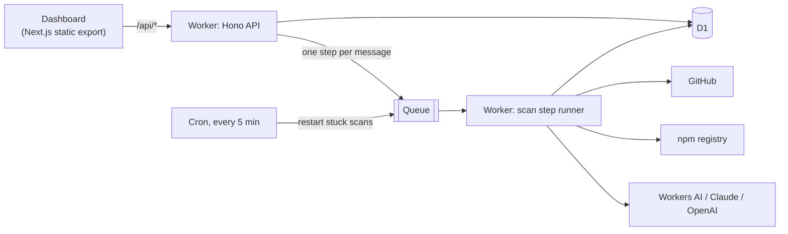

# UpgradePilot

UpgradePilot analyses the npm dependencies of a public GitHub repository and tells you what to upgrade, how risky each upgrade is, and in what order to do it. It reads the repository's lockfiles to find what is actually installed, compares that with the npm registry, collects release notes and migration guides, rates risk with deterministic rules, and optionally adds an AI reading of the evidence. The result is a report with an ordered upgrade plan and a migration checklist, exported as Markdown or JSON.

It runs entirely on the Cloudflare Workers Free plan: Workers, D1, Queues, Workers AI and static assets.

**Live demo:** https://upgradepilot.upgradepilot-api.workers.dev (shared demo with hourly limits). See also [an example report](docs/example-report.md) from a real scan of `vercel/ms`.

## What it does

1. **Reads the repository.** Validates the GitHub URL, lists branches, pins the scan to one commit, and finds the project's `package.json` files, including npm, Yarn and pnpm workspaces.
2. **Finds installed versions.** Reads `package-lock.json` (v1 to v3), `pnpm-lock.yaml` (v5 to v9, including the pnpm 11 format) and `yarn.lock` (classic and Berry). When the installed version cannot be established it is marked unresolved with a reason, never guessed.
3. **Checks the registry.** Latest stable version, latest within the declared range, latest without a breaking change, deprecations. Classifies each upgrade as patch, minor or major.
4. **Collects evidence.** GitHub releases, `CHANGELOG.md` sections and migration guides between the installed and target versions, each stored with its URL and retrieval status.
5. **Rates risk with rules.** Major and 0.x upgrades, deprecated packages, a raised Node.js requirement, peer dependency conflicts, breaking-change notes, and npm security advisories the upgrade fixes.
6. **Adds AI analysis (optional).** Workers AI, Claude or OpenAI reads the evidence for risky upgrades. Output is validated against a schema, must cite the sources it was given, and can raise a risk rating but never lower one. Repository text is treated as untrusted.
7. **Reports.** Safe, review and high-risk groups, an ordered upgrade plan, a migration checklist, and every finding labelled as rule-based, AI, or unverified AI claim.

The dashboard starts scans, shows live progress, filters and searches dependencies, opens the full evidence for any upgrade, re-runs AI analysis, and keeps scan history.

## How it works



- **One Worker** serves the API, the dashboard's static files, the queue consumer and the cron sweep.
- **Scans are a state machine** stored in D1. Each queue message runs one small step (about 4 packages or 3 upgrades), so every step stays inside the Free plan's 10 ms CPU and 50 network calls. Leases and step numbers stop duplicate messages from running a step twice, and a crashed step resumes from what is still pending.
- **Rules first, AI second.** Version detection, classification and the baseline risk work without AI.
- **Abuse limits.** Hourly caps on scans, repository checks and re-analysis, and a daily cap on AI calls, so a public demo cannot exhaust the free quotas.

Details: [architecture](docs/ARCHITECTURE.md), [design decisions and build log](docs/DECISIONS.md), [deployment](docs/DEPLOYMENT.md).

## Tech stack

| Area | Tools |
| --- | --- |
| API and scan engine | TypeScript, Cloudflare Workers, Hono, Zod |
| Storage and jobs | Cloudflare D1, Cloudflare Queues, Cron Triggers |
| AI | Workers AI (default), Anthropic SDK (`claude-opus-5-5`), OpenAI |
| Dashboard | Next.js 16 (static export), React 19, Tailwind CSS 4, shadcn/ui, TanStack Query |
| Tests | Vitest, with integration tests against a real local D1 through Wrangler |

## Layout

```
apps/api           Cloudflare Worker: API, scan pipeline, D1 migrations
apps/web           Next.js dashboard (static export, served by the API Worker)
packages/shared    Zod schemas shared by the API and the dashboard
docs/              Architecture, decisions, deployment guide, example report
```

## Run it locally

Requirements: Node.js 20 or newer. No Cloudflare account is needed.

```bash
npm install
```

```bash
cp apps/api/.dev.vars.example apps/api/.dev.vars
```

Optional: put a GitHub token in `apps/api/.dev.vars` as `GITHUB_TOKEN`. It raises the GitHub limit from 60 to 5,000 requests an hour.

```bash
npm run db:migrate:local -w @upgradepilot/api
```

```bash
npm run dev
```

The API runs on `http://localhost:8787`. In a second terminal, start the dashboard, which proxies `/api` to the Worker:

```bash
npm run dev:web
```

Open `http://localhost:3000`.

To run the production setup instead (the Worker serving the built dashboard), build the site, run `npm run dev`, and open `http://localhost:8787`:

```bash
npm run build
```

Local mode has no Workers AI, so AI analysis is skipped and reports use the rules only. To try AI locally, set `AI_PROVIDER=anthropic` and `ANTHROPIC_API_KEY` in `apps/api/.dev.vars`, or log in with `npx wrangler login` and run `npm run dev:remote-ai -w @upgradepilot/api` to use real Workers AI.

## Checks

```bash
npm test
```

```bash
npm run typecheck
```

## API

| Method and path | Purpose |
| --- | --- |
| `GET /api/health` | App and database health |
| `POST /api/repositories/inspect` | Validate a GitHub URL; return repository details and branches |
| `GET /api/repositories` | Scanned repositories with their latest scan (paginated) |
| `GET /api/repositories/:repositoryId/scans` | Scan history (paginated) |
| `GET /api/dashboard` | Totals and recent scans |
| `POST /api/scans` | Start a scan: `{ "url", "branch" }`, optional `Idempotency-Key` header |
| `GET /api/scans/:scanId` | Status, progress and stage |
| `GET /api/scans/:scanId/dependencies` | Dependencies with filters (`upgradeType`, `dependencyType`, `riskLevel`, `recommendation`, `q`), sorting and paging |
| `GET /api/scans/:scanId/dependencies/:dependencyId` | One dependency with risk details, advisories, AI analysis and evidence |
| `GET /api/scans/:scanId/report` | The report as JSON, or `?format=markdown` for a download |
| `POST /api/scans/:scanId/reanalyze` | Re-run analysis for chosen upgrades: `{ "dependencyIds": [...], "force": false }` |

Errors share one shape: `{ "error": { "code", "message", "details?", "requestId" } }`.

## Deploy

Follow [docs/DEPLOYMENT.md](docs/DEPLOYMENT.md). In short: `wrangler login`, create the D1 database and the queue, apply migrations, add `GITHUB_TOKEN`, and run `npm run deploy`.

## Limitations

- Public GitHub repositories and npm dependencies only.
- Transitive dependencies are not analysed.
- Release notes come from GitHub releases, changelogs and migration guides in the repository; documentation sites are not crawled.
- Very large npm version lists (over 5 MB, for example `next`) are not downloaded, so "latest in range" can be missing for those packages.
- AI output is advisory. The report marks which findings come from AI and which could not be traced to a source.
