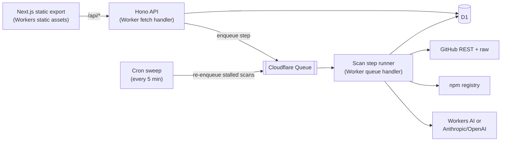
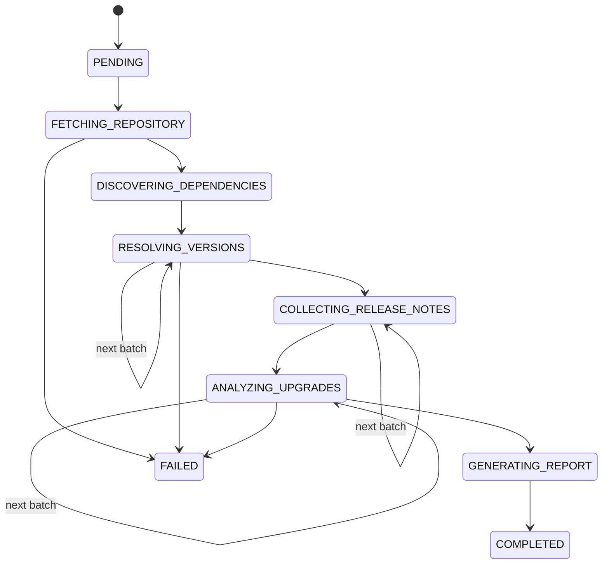

# UpgradePilot architecture

UpgradePilot reads a public GitHub repository, finds its npm dependencies, compares them with the npm registry, collects release evidence, and produces an upgrade report. AI interprets the evidence. Version detection, comparison and the baseline risk rating are deterministic and work without AI.

Decisions and their reasons are in [DECISIONS.md](DECISIONS.md). This file describes the shape of the system.

## Constraints that drive the design

The app runs on the Cloudflare Workers Free plan only. These limits come from the Cloudflare docs, read on 24 Nov 2026:

| Limit (Free plan) | Value | Design consequence |
| --- | --- | --- |
| CPU per invocation | 10 ms | No heavy parsing in one request. Lockfiles are scanned, not fully parsed. Work is split into small steps. |
| Subrequests per invocation | 50 | A scan cannot run in one request. Each step does a bounded batch of fetches. |
| D1 queries per invocation | 50 (a `batch()` counts as one) | Writes are batched. |
| Requests per day | 100,000 | Plenty for a personal tool. |
| Queues | 10,000 operations/day, 24 h retention | One message per scan step. A 200-package scan uses roughly 100 operations. |
| KV writes | 1,000/day | KV is not used. The npm cache and AI results both live in D1 (100,000 row writes/day). |
| D1 rows | 5M read, 100k written per day | Comfortable. A 200-package scan writes roughly 1,500 rows including evidence. |
| Workers AI | 10,000 neurons/day | AI runs only for upgrades with evidence, and results are cached by input hash. |
| Static assets | Free and unlimited | The frontend is a static export served by the same Worker. |

Two figures are unconfirmed and are treated conservatively: whether queue consumers on Free get 10 ms or 30 s of CPU (the docs disagree), and the D1 daily row limits (not on the limits page). We assume 10 ms.

## System overview



One Worker holds three entry points: `fetch` (API and static assets), `queue` (scan steps) and `scheduled` (recovery sweep). It is one deploy, one origin and no CORS.

## Repository structure

```
upgradepilot/
├── package.json              npm workspaces root, no other monorepo tooling
├── tsconfig.base.json        strict settings shared by every package
├── apps/
│   ├── api/                  Cloudflare Worker (Hono)
│   │   ├── wrangler.jsonc
│   │   ├── migrations/       D1 SQL migrations
│   │   ├── src/
│   │   │   ├── index.ts      Worker entry (fetch, later queue + scheduled)
│   │   │   ├── app.ts        Hono app, middleware, error mapping
│   │   │   ├── routes/       HTTP layer only: validate, call a module, shape the response
│   │   │   ├── lib/          http client, logger, errors, concurrency helper
│   │   │   └── modules/      business logic, one folder per module
│   │   └── test/
│   └── web/                  Next.js App Router, static export (Phase 4)
├── packages/
│   └── shared/               Zod schemas for API contracts, used by api and web
└── docs/
```

## Modules

Modules hold business logic and take their dependencies as arguments (an `HttpClient`, a `RepositoryFiles` reader, a storage interface). Only `routes/`, `index.ts` and the storage module touch Cloudflare bindings. That keeps the logic testable in plain Node.

| Module | Responsibility | Phase |
| --- | --- | --- |
| RepositoryModule | Parse and allowlist GitHub URLs, read repo metadata and branches, resolve a branch to a commit, list the file tree, read files by commit SHA | 1 |
| DependencyDiscoveryModule | Pick which `package.json` files to read, parse manifests, classify each version spec, read installed versions from lockfiles | 1 |
| VersionResolutionModule | Fetch npm metadata, find latest stable, latest in range, deprecation, engines; classify patch, minor, major, up to date or unresolved | 2 |
| ReleaseNotesModule | Gather GitHub releases, CHANGELOG and MIGRATION files between current and target; record source URL, status and content hash | 2 |
| UpgradeAnalysisModule | Deterministic risk rules (major bump, deprecation, engines, peer ranges, breaking-change markers in notes) | 3 |
| AIAnalysisModule | Provider interface (Workers AI, Anthropic, OpenAI), prompt building with untrusted-content fencing, Zod validation, input-hash cache | 3 |
| ReportModule | Combine deterministic and AI results into groups, an ordered plan, Markdown and JSON | 3 |
| ScanOrchestrationModule | State machine, checkpoints, leases, step scheduling, retry and recovery | 2 |
| StorageModule | D1 queries for scans, dependencies and evidence (batched, idempotent writes), D1-backed npm cache | 1 (schema), 2 (code) |

## Scan data flow



1. `POST /api/scans` checks the repository and branch exist (404 otherwise), upserts the repository, and inserts a `PENDING` scan. An `Idempotency-Key` header and a partial unique index (one active scan per repository and branch) block duplicates. It enqueues `{ scanId, step: 0 }` and returns the scan ID.
2. Each queue message says "advance scan X from step N". The runner leases the scan row with a conditional `UPDATE` (right step, unfinished, no live lease), runs the handler for the current status, then commits the stage's writes and the next state in one D1 batch, and enqueues step N+1.
3. The status names the work in progress. Every committed step increments `step_seq`. A message carrying an old step number is dropped, so a duplicate or recovered message cannot start a second chain.
4. Long stages are resumable from the data, not from a cursor. Rows with `upgrade_type IS NULL` still need version resolution. Upgrades without `release_sources` rows still need evidence. A crashed or repeated step picks up whatever is still pending, and every write is idempotent (delete-then-insert or update by ID).
5. Batches: 4 packages per resolution step, 3 upgrades per release-note step. That keeps each step under 50 subrequests and 50 D1 queries.
6. Rate limits release the lease without spending an attempt and re-enqueue with the upstream's delay (30 s to 1 h). `AppError`s (branch deleted, repository went private) fail the scan at once. Other errors back off (15 s, 30 s, 60 s) and fail the scan after 4 attempts.
7. A cron sweep every 5 minutes re-enqueues unfinished scans with no live lease, no scheduled retry, and no progress for 3 minutes. It also deletes expired cache rows.
8. The UI polls `GET /api/scans/:id` for status and progress.

`ANALYZING_UPGRADES` runs three resumable passes, each driven by row state:

1. **Advisories**: one POST to npm's bulk advisory endpoint for every installed version (`advisories IS NULL`). If npm fails, rows are marked `unavailable` and the report says so.
2. **Deterministic risk**: for every upgrade with no `risk_level`, apply the rules below and decide which upgrades need AI (`analysis_status`).
3. **AI**: two upgrade groups per step (same package and versions across manifests), riskiest first, capped per scan.

`GENERATING_REPORT` builds the report from the rows and stores it as JSON on the scan. `GET /report` serves that snapshot, as JSON or Markdown.

AI is optional at step `ANALYZING_UPGRADES`. If no provider is configured or the budget is spent, the step records "AI unavailable" and the report uses deterministic results only.

## Dependency discovery rules (Phase 1)

- Manifests: the root `package.json` plus the workspaces it declares (`workspaces` field or `pnpm-workspace.yaml`). Without workspaces, the root plus `package.json` files one folder deep, skipping `examples`, `test`, `fixtures`, `docs` and similar folders. At most 20 manifests. Skipped manifests are listed, not silently dropped.
- Spec kinds: `range`, `tag` (`latest`), `alias` (`npm:pkg@range`), `workspace`, `catalog`, `local` (`file:`, `link:`), `git`, `url`, `invalid`.
- Installed version: taken from the lockfile that covers the manifest (same folder, or the repo root for workspace members), or from an exact pin such as `"1.2.3"` when no lockfile exists. Otherwise it is `null` with a reason (`NO_LOCKFILE`, `NOT_IN_LOCKFILE`, `WORKSPACE_PACKAGE` and others). The system never guesses from a range.
- Lockfiles: `package-lock.json` v1 to v3, `pnpm-lock.yaml` v5 to v9 (including the two-document format from pnpm 11+), `yarn.lock` classic and Berry.
- Ordering: the root first, then the repository's own packages, then example and test projects that the workspaces happen to include. That way the 20-manifest cap drops examples before real packages.

## Risk rules (Phase 3)

Risk means "what could break if we upgrade". Reasons mean "why upgrade". Both are deterministic.

| Factor | Level |
| --- | --- |
| Major version upgrade | high |
| Minor upgrade on a `0.x` version (breaking under caret rules) | medium |
| Target (latest) version deprecated, so the whole package is | high |
| `engines.node` minimum raised | medium |
| Target peer dependency not satisfied by the version in the same manifest | high |
| New peer dependency not present | low |
| "BREAKING" or "breaking change" in release notes, changelog or migration guide | medium for patch/minor, high for major |

Reasons: security advisories the target fixes (npm bulk advisories; only when the target is outside the vulnerable range), installed version deprecated, major versions behind, newer release available.

Recommendation: low risk → `upgrade`, medium or high → `investigate`. Deterministic rules never `defer`.

AI runs only for upgrades that are major, medium or high risk, or have breaking-change markers, and only when release-note, changelog or migration text exists. Everything else is `not_needed` or `insufficient_evidence`, so no AI request is made.

## AI analysis (Phase 3)

- **Providers**: Workers AI (default, `@cf/meta/llama-3.3-70b-instruct-fp8-fast`, JSON mode), Anthropic (official SDK, `claude-opus-5-5`, structured outputs, server-side refusal fallbacks), or OpenAI (`fetch`, JSON schema; `AI_MODEL` required). Chosen by `AI_PROVIDER`; keys are Cloudflare secrets.
- **Budget**: about 365 neurons per Workers AI analysis (6k tokens in, 1k out), so the free 10,000 neurons a day covers about 27. `AI_MAX_ANALYSES_PER_SCAN` (default 10) caps each scan; the riskiest upgrades go first.
- **Input**: package, versions, manifests, the deterministic findings, release evidence (capped at 24,000 characters), candidate files (the manifests plus config files named after the package, such as `eslint.config.js`), and up to two of those config files' contents.
- **Prompt injection**: evidence and file contents sit inside `<untrusted_source>` and `<repository_file>` blocks; tags inside the content are neutralised; the system prompt says the content is data and its instructions must be ignored.
- **Validation**: the answer must pass a Zod schema. Package and versions come from our data, never the model. A claim citing a URL or file not given to the model is kept but marked `unverified` with no link. Affected files outside the candidate list are dropped. Confidence is clamped to 0 to 1. An empty answer is marked inconclusive.
- **Merging (ADR-008)**: AI can raise the risk level only when it cites at least one given source, and never lowers it. The recommendation becomes the more cautious of the two. Inconclusive answers change nothing.
- **Failures**: a malformed or refused answer marks that upgrade `failed`, and the deterministic result stands. A rate limit pauses the scan like GitHub and npm do. A missing key, exhausted quota or `wrangler dev --local` (no Workers AI) marks the remaining upgrades `skipped` with the reason.
- **Cache**: results are stored with their input hash and reused for the same input in any scan. Reanalysis with `force: true` bypasses it.

## Report (Phase 3)

Upgrades are merged across manifests by package and versions, then grouped: **safe** (low risk, recommend upgrade), **high-risk migrations** (high risk), **review before upgrading** (everything else). The ordered plan puts upgrades that fix security advisories first, then safe, review and high-risk. Every finding carries its origin: deterministic, AI, or unverified AI claim. The Markdown export escapes untrusted text and only links `http(s)` URLs.

## Frontend (Phase 4)

- **Stack**: Next.js 16 App Router, React 19, Tailwind 4, shadcn/ui (Radix), TanStack Query 5. Every API response is validated in the browser with the same Zod schemas the API uses (`packages/shared`).
- **Hosting**: `next build` produces a static export (`apps/web/out`). The API Worker serves it as static assets, and `run_worker_first: ["/api/*"]` sends API calls to the Worker. One origin, no CORS, and static requests are free on Workers.
- **Routes**: `/` (dashboard and new-scan form), `/scan/?id=` (progress, dependency table, detail panel, report tab), `/repositories/` and `/repository/?id=` (history). IDs travel as query parameters, because a static export cannot pre-render unknown IDs.
- **Live progress**: TanStack Query polls a scan every 2 seconds while it is running, and the dependency table refreshes alongside it.
- **Local dev**: `next dev` uses a separate config that proxies `/api` to `wrangler dev` on port 8787, because rewrites are not allowed with `output: "export"`.
- **Untrusted text**: release notes, changelog excerpts and AI text render as plain React text. Links are only rendered for `http(s)` URLs.

| Endpoint added for the UI | Purpose |
| --- | --- |
| `GET /api/dashboard` | Totals over the latest completed scan per repository, plus the 10 most recent scans |
| `GET /api/repositories` | Paginated repositories with their newest scan |
| `GET /api/repositories/:repositoryId/scans` | Paginated scan history with headline counts |
| `GET /api/scans/:scanId/dependencies/:dependencyId` | One dependency with risk details, advisories, AI analysis and evidence excerpts |

## Known risks

- **CPU on large repos.** The recursive tree listing for a big monorepo is several MB of JSON. TanStack/query took 25 subrequests and parsed fine in Node, but we have not measured it against the 10 ms Free limit in production. If it fails there, the fallback is to list only the workspace folders through the Contents API instead of the whole tree.
- **Lockfile size.** Lockfiles over 10 MB are skipped, and their dependencies are marked `LOCKFILE_UNREADABLE`.
- **D1 query budget per step.** A resolution step can use up to about 45 of the 50 D1 queries when every cache lookup misses and writes back. A package installed at many different versions across manifests adds 2 queries per extra version. If deploys show "too many queries", lower `RESOLVE_BATCH` in `stages.ts`.
- **GitHub API quota without a token.** Each upgrade with a GitHub repository costs one `releases` API call. Unauthenticated, that is 60 an hour, shared with repository lookups. Large scans wait out the limit (the runner reschedules) unless `GITHUB_TOKEN` is set.
- **Workers AI needs Cloudflare even in local dev.** `npm run dev` runs `wrangler dev --local`, where Workers AI does not exist, so AI analysis is skipped locally unless `AI_PROVIDER` is `anthropic` or `openai`. `npm run dev:remote-ai` uses real Workers AI after `wrangler login`, and spends free neurons.
- **AI not verified live.** The Anthropic and OpenAI paths are tested against faked HTTP responses and the Workers AI path against a fake binding. None has been run against the real service yet.
- **Cache API on workers.dev.** The docs do not confirm the Cache API works on `*.workers.dev`, so it is not used. If the app moves to a custom domain, raw GitHub files could be cached there.

## API

All responses are JSON validated against schemas in `packages/shared`. Errors share one shape:

```json
{ "error": { "code": "REPOSITORY_NOT_FOUND", "message": "…", "details": {}, "requestId": "…" } }
```

| Method and path | Purpose | Phase |
| --- | --- | --- |
| `GET /api/health` | App and D1 health | 1 |
| `POST /api/repositories/inspect` | Validate URL, return repo metadata and branches | 1 |
| `POST /api/scans` | Create or reuse a scan, return its ID | 2 |
| `GET /api/scans/:scanId` | Status, stage, progress, error | 2 |
| `GET /api/scans/:scanId/dependencies` | Paginated, filterable dependency list | 2 |
| `GET /api/scans/:scanId/report` | Consolidated report. `?format=markdown` returns a `.md` download. 409 until the scan completes | 3 |
| `POST /api/scans/:scanId/reanalyze` | `{ dependencyIds (1-20), force? }`. Re-runs risk and AI for those upgrades of a completed scan. `force` skips the cache. 202, or 409 while running | 3 |
| `GET /api/repositories` | Analysed repositories, paginated | 4 |
| `GET /api/repositories/:repositoryId/scans` | Scan history, paginated | 4 |
| `GET /api/dashboard` | Dashboard totals and recent scans | 4 |
| `GET /api/scans/:scanId/dependencies/:dependencyId` | Dependency detail | 4 |

## Data model

Defined in `apps/api/migrations/0001_initial.sql`. Main points:

- `repositories`: unique on `(owner, name)` case-insensitive.
- `scans`: state, progress, checkpoint JSON, lease expiry, attempt count, idempotency key. A partial unique index allows one active scan per repository and branch.
- `dependencies`: one row per manifest, dependency type and package. Holds the declared spec, spec kind, installed version and its source, registry results, upgrade type, deterministic risk level and risk factors.
- `upgrade_analyses`: AI output per dependency with model, input hash and an `inconclusive` flag. Kept apart from deterministic fields so the report can label each finding's origin.
- `release_sources`: one row per evidence source with URL, type, status, content hash and a capped excerpt.

## Caching

| What | Where | Key | TTL |
| --- | --- | --- | --- |
| npm dist-tags (and "package not found") | D1 `registry_cache` | `npm:dist-tags:<name>` | 1 hour |
| One version's manifest (reduced) | D1 `registry_cache` | `npm:version:<name>@<version>` | 7 days (immutable) |
| Full version list (or a "too large" marker) | D1 `registry_cache` | `npm:versions:<name>` | 1 hour |
| AI analysis | D1 `upgrade_analyses` (reused across scans) | `input_hash`: SHA-256 of provider, model, prompt version and the full analysis input | Until the input changes |

GitHub responses are not cached. One scan reads each file once, and evidence is stored per scan in `release_sources`.

## Version resolution rules (Phase 2)

- Small npm endpoints first: `dist-tags` (about 100 bytes) and one version's manifest (about 3 KB). The full version list is 8.8 MB for `typescript` and 25.7 MB for `next`, too much to parse in 10 ms. It is fetched only when the dist-tags cannot answer, capped at 5 MB. Above the cap the field stays empty with `VERSION_LIST_TOO_LARGE`.
- **Latest**: npm's `latest` dist-tag when it is a stable version, otherwise the highest stable version. Prereleases are excluded throughout.
- **Latest in range**: the highest stable version that satisfies the declared range (`dist-tags[tag]` for tag specs).
- **Latest compatible**: the highest stable version that satisfies `^installed`, the newest non-breaking upgrade.
- **Upgrade type**: `semver.diff(installed, latest)` mapped to patch, minor or major. `up_to_date` when installed is at or above latest. `unresolved` when the installed version is unknown, even though latest and in-range are still filled in.
- **Deprecated**: the latest version's deprecation (the whole package) wins over the installed version's.
- Engines, peer dependencies, deprecation and repository for the current and target versions go in `registry_facts` for Phase 3's risk rules.

## Release evidence rules (Phase 2)

- Repository from the target version's npm manifest. GitHub only. Anything else is recorded as `skipped`.
- Sources: GitHub releases in `(current, target]` (first page of 100, monorepo tags like `pkg@1.2.3` matched by package name), the matching `CHANGELOG.md` sections (package folder, then root), and `MIGRATION.md` or `UPGRADING.md` for major upgrades. One `npm_metadata` item records the engines, peers and deprecation of both versions.
- Every source gets a row with its URL and status (`ok`, `not_found`, `failed`, `too_large`, `skipped`), even when nothing was found.
- Excerpt budget: 16,000 characters per upgrade, 6,000 per item. Priority order: migration guide, changelog, major releases (`x.0.0`), then other releases newest first. Items over budget keep their URL and hash but have no excerpt.

## Security

- Only `https` URLs to `github.com`, `api.github.com`, `raw.githubusercontent.com` and `registry.npmjs.org` are fetched. The HTTP client enforces the allowlist on every request and every redirect.
- Every fetch has a timeout and a response size cap. Request bodies are capped at 16 KB.
- Repository code is never run, installed or evaluated. Files are read as text only.
- Repository files, changelogs and release notes are untrusted. In AI prompts they sit inside delimited blocks, and the system prompt tells the model to treat them as data. Output must pass a Zod schema, and versions in the output are checked against the registry data. Claims without a source are marked unverified.
- `GITHUB_TOKEN`, `ANTHROPIC_API_KEY` and `OPENAI_API_KEY` live in Cloudflare secrets (`.dev.vars` locally). The browser never sees a key.
- AI output never becomes markup: the dashboard renders it as React text, the Markdown export escapes it, and only `http(s)` URLs become links.
- **Abuse limits** (Phase 5): the app has no accounts, so expensive work is capped with fixed-window counters in D1 (`rate_counters`), which only write while under the limit:
  - repository checks, new scans and re-analysis per hour, globally and per client (a quarter of the global cap, keyed by a truncated SHA-256 of the client IP, never the raw address);
  - AI model calls per UTC day, and per scan for its whole life (re-analysis included);
  - at most 300 distinct npm packages and 20 release-note items per upgrade per scan;
  - a scan fails after 4 attempts (including runs killed by the CPU limit, which never report an error) or 6 hours, so nothing retries forever.
  Over a limit the API returns `429 RATE_LIMITED` with `Retry-After`. Cloudflare's rate-limiting binding was not used: it is not confirmed for the Free plan, counts per location, and its docs advise against IP keys.
- **Untrusted patterns and text** (Phase 5): workspace globs from repositories are matched segment by segment without regular expressions, and changelog lines longer than 200 characters are skipped, so crafted input cannot cause catastrophic backtracking. npm and repository strings in AI prompts are stripped of control characters and tag-neutralised.
- **Requests**: JSON bodies must be sent as `application/json` (415 otherwise), which blocks cross-site form posts without a CORS preflight. `page` is capped at 1000.
- **Headers** (Phase 5): static pages get a Content Security Policy (`default-src 'self'`, no framing), `nosniff` and a referrer policy from `apps/web/public/_headers`. API responses get Hono's `secureHeaders()`. The CSP allows inline scripts because the Next.js static export inlines its bootstrap data.

## Implementation plan

| Phase | Scope | Done when |
| --- | --- | --- |
| 1 | Monorepo, Worker config, D1 migration, safe HTTP client, GitHub module, manifest and lockfile parsing, `health` and `inspect` endpoints | Unit and endpoint tests pass, migration applies locally, `inspect` works against a real repo in `wrangler dev` |
| 2 | npm resolution, semver classification, release-note collection, queue-driven orchestration, scan endpoints, caching | A real repo scans end to end locally without AI |
| 3 | Deterministic risk rules, AI providers, prompt and validation, report and exports | Report generated with and without AI |
| 4 | Next.js dashboard, scan page, dependency table and details, history, export buttons | UI drives a full scan locally |
| 5 | Failure-path tests, security review, abuse limits, README, deploy guide, example report | Deploy dry run passes; the real deploy needs the owner's Cloudflare login |
