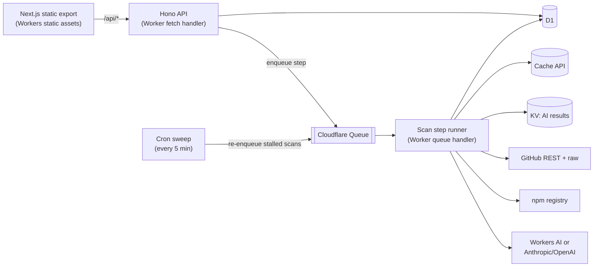
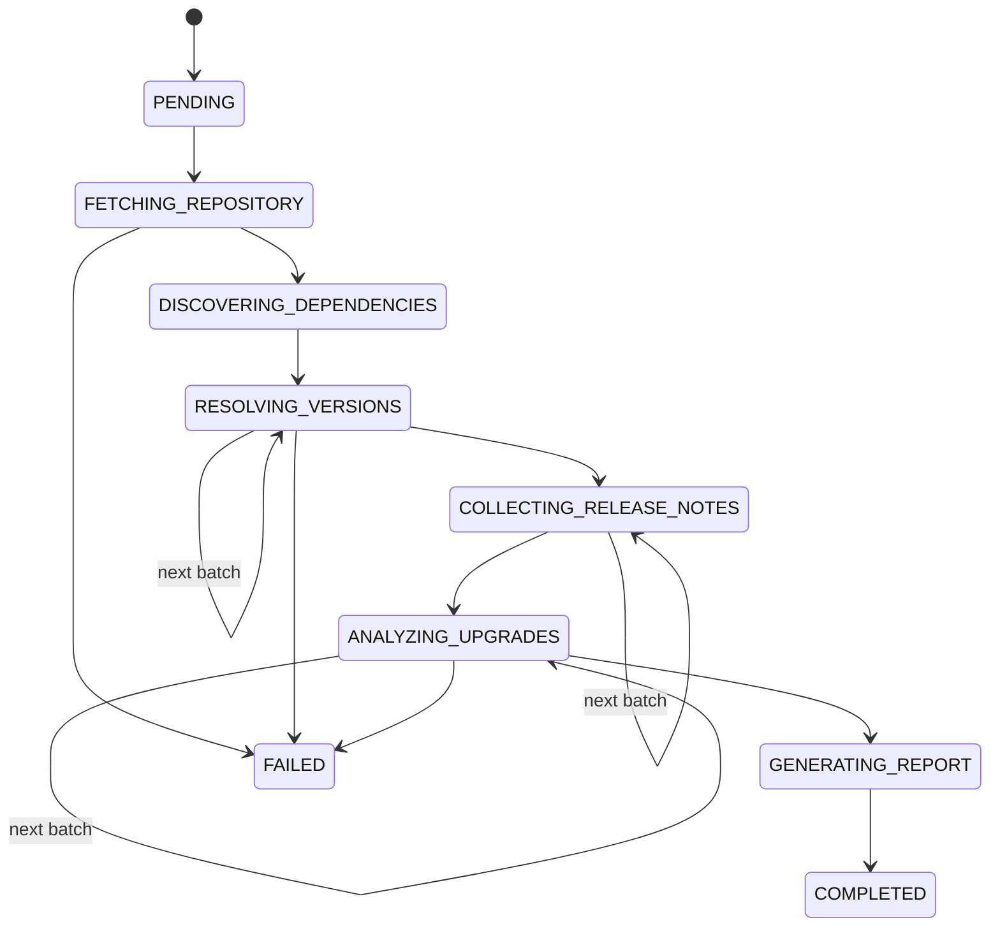

# UpgradePilot architecture

UpgradePilot reads a public GitHub repository, finds its npm dependencies, compares them with the npm registry, collects release evidence, and produces an upgrade report. AI interprets the evidence. Version detection, comparison and the baseline risk rating are deterministic and work without AI.

Decisions and their reasons are in [DECISIONS.md](DECISIONS.md). This file describes the shape of the system.

## Constraints that drive the design

The app runs on the Cloudflare Workers Free plan only. These limits come from the Cloudflare docs, read on 24 Nov 2026:

| Limit (Free plan) | Value | Design consequence |
| --- | --- | --- |
| CPU per invocation | 10 ms | No heavy parsing in one request. Lockfiles are scanned, not fully parsed. Work is split into small steps. |
| Subrequests per invocation | 50 | A scan cannot run in one request. Each step does a bounded batch of fetches. |
| D1 queries per invocation | 50 (a `batch()` counts as one) | Writes are batched. |
| Requests per day | 100,000 | Plenty for a personal tool. |
| Queues | 10,000 operations/day, 24 h retention | One message per scan step. A 200-package scan uses roughly 100 operations. |
| KV writes | 1,000/day | KV holds only AI results. HTTP responses go to the Cache API, which has no daily write cap. |
| Workers AI | 10,000 neurons/day | AI runs only for upgrades with evidence, and results are cached by input hash. |
| Static assets | Free and unlimited | The frontend is a static export served by the same Worker. |

Two figures are unconfirmed and are treated conservatively: whether queue consumers on Free get 10 ms or 30 s of CPU (the docs disagree), and the D1 daily row limits (not on the limits page). We assume 10 ms.

## System overview



One Worker holds three entry points: `fetch` (API and static assets), `queue` (scan steps) and `scheduled` (recovery sweep). It is one deploy, one origin and no CORS.

## Repository structure

```
upgradepilot/
├── package.json              npm workspaces root, no other monorepo tooling
├── tsconfig.base.json        strict settings shared by every package
├── apps/
│   ├── api/                  Cloudflare Worker (Hono)
│   │   ├── wrangler.jsonc
│   │   ├── migrations/       D1 SQL migrations
│   │   ├── src/
│   │   │   ├── index.ts      Worker entry (fetch, later queue + scheduled)
│   │   │   ├── app.ts        Hono app, middleware, error mapping
│   │   │   ├── routes/       HTTP layer only: validate, call a module, shape the response
│   │   │   ├── lib/          http client, logger, errors, concurrency helper
│   │   │   └── modules/      business logic, one folder per module
│   │   └── test/
│   └── web/                  Next.js App Router, static export (Phase 4)
├── packages/
│   └── shared/               Zod schemas for API contracts, used by api and web
└── docs/
```

## Modules

Modules hold business logic and take their dependencies as arguments (an `HttpClient`, a `RepositoryFiles` reader, a storage interface). Only `routes/`, `index.ts` and the storage module touch Cloudflare bindings. That keeps the logic testable in plain Node.

| Module | Responsibility | Phase |
| --- | --- | --- |
| RepositoryModule | Parse and allowlist GitHub URLs, read repo metadata and branches, resolve a branch to a commit, list the file tree, read files by commit SHA | 1 |
| DependencyDiscoveryModule | Pick which `package.json` files to read, parse manifests, classify each version spec, read installed versions from lockfiles | 1 |
| VersionResolutionModule | Fetch npm metadata, find latest stable, latest in range, deprecation, engines; classify patch, minor, major, up to date or unresolved | 2 |
| ReleaseNotesModule | Gather GitHub releases, CHANGELOG and MIGRATION files between current and target; record source URL, status and content hash | 2 |
| UpgradeAnalysisModule | Deterministic risk rules (major bump, deprecation, engines, peer ranges, breaking-change markers in notes) | 3 |
| AIAnalysisModule | Provider interface (Workers AI, Anthropic, OpenAI), prompt building with untrusted-content fencing, Zod validation, input-hash cache | 3 |
| ReportModule | Combine deterministic and AI results into groups, an ordered plan, Markdown and JSON | 3 |
| ScanOrchestrationModule | State machine, checkpoints, leases, step scheduling, retry and recovery | 2 |
| StorageModule | D1 repositories (typed queries, batched writes), KV and Cache API wrappers | 1 (schema), 2 (code) |

## Scan data flow



1. `POST /api/scans` validates input, upserts the repository, and inserts a `PENDING` scan. An idempotency key and a partial unique index (one active scan per repo and branch) block duplicates. It enqueues the first step and returns the scan ID.
2. Each queue message says "advance scan X". The runner takes a short lease on the scan row (conditional `UPDATE`), does one bounded unit of work, writes results and the new checkpoint in one D1 batch, releases the lease, and enqueues the next step.
3. A unit of work is one stage transition or one batch (about 8 packages) inside a long stage. The batch size keeps each step under 50 subrequests.
4. Upstream rate limits re-enqueue the step with a delay instead of failing. Other errors retry with backoff up to a cap, then mark the scan `FAILED` with the message.
5. A cron sweep every 5 minutes re-enqueues scans whose lease has expired and are not finished. That covers lost messages and crashed steps.
6. The UI polls `GET /api/scans/:id` for status and progress.

AI is optional at step `ANALYZING_UPGRADES`. If no provider is configured or the budget is spent, the step records "AI unavailable" and the report uses deterministic results only.

## Dependency discovery rules (Phase 1)

- Manifests: the root `package.json` plus the workspaces it declares (`workspaces` field or `pnpm-workspace.yaml`). Without workspaces, the root plus `package.json` files one folder deep, skipping `examples`, `test`, `fixtures`, `docs` and similar folders. At most 20 manifests. Skipped manifests are listed, not silently dropped.
- Spec kinds: `range`, `tag` (`latest`), `alias` (`npm:pkg@range`), `workspace`, `catalog`, `local` (`file:`, `link:`), `git`, `url`, `invalid`.
- Installed version: taken from the lockfile that covers the manifest (same folder, or the repo root for workspace members), or from an exact pin such as `"1.2.3"` when no lockfile exists. Otherwise it is `null` with a reason (`NO_LOCKFILE`, `NOT_IN_LOCKFILE`, `WORKSPACE_PACKAGE` and others). The system never guesses from a range.
- Lockfiles: `package-lock.json` v1 to v3, `pnpm-lock.yaml` v5 to v9 (including the two-document format from pnpm 11+), `yarn.lock` classic and Berry.
- Ordering: the root first, then the repository's own packages, then example and test projects that the workspaces happen to include. That way the 20-manifest cap drops examples before real packages.

## Known risks

- **CPU on large repos.** The recursive tree listing for a big monorepo is several MB of JSON. TanStack/query took 25 subrequests and parsed fine in Node, but we have not measured it against the 10 ms Free limit in production. If it fails there, the fallback is to list only the workspace folders through the Contents API instead of the whole tree.
- **Lockfile size.** Lockfiles over 10 MB are skipped, and their dependencies are marked `LOCKFILE_UNREADABLE`.

## API

All responses are JSON validated against schemas in `packages/shared`. Errors share one shape:

```json
{ "error": { "code": "REPOSITORY_NOT_FOUND", "message": "…", "details": {}, "requestId": "…" } }
```

| Method and path | Purpose | Phase |
| --- | --- | --- |
| `GET /api/health` | App and D1 health | 1 |
| `POST /api/repositories/inspect` | Validate URL, return repo metadata and branches | 1 |
| `POST /api/scans` | Create or reuse a scan, return its ID | 2 |
| `GET /api/scans/:scanId` | Status, stage, progress, error | 2 |
| `GET /api/scans/:scanId/dependencies` | Paginated, filterable dependency list | 2 |
| `GET /api/scans/:scanId/report` | Consolidated report (`?format=md` for Markdown) | 3 |
| `POST /api/scans/:scanId/reanalyze` | Re-run AI for selected dependencies | 3 |
| `GET /api/repositories` | Analysed repositories, paginated | 4 |
| `GET /api/repositories/:repositoryId/scans` | Scan history, paginated | 4 |

## Data model

Defined in `apps/api/migrations/0001_initial.sql`. Main points:

- `repositories`: unique on `(owner, name)` case-insensitive.
- `scans`: state, progress, checkpoint JSON, lease expiry, attempt count, idempotency key. A partial unique index allows one active scan per repository and branch.
- `dependencies`: one row per manifest, dependency type and package. Holds the declared spec, spec kind, installed version and its source, registry results, upgrade type, deterministic risk level and risk factors.
- `upgrade_analyses`: AI output per dependency with model, input hash and an `inconclusive` flag. Kept apart from deterministic fields so the report can label each finding's origin.
- `release_sources`: one row per evidence source with URL, type, status, content hash and a capped excerpt.

## Caching

| What | Where | Key | TTL |
| --- | --- | --- | --- |
| npm package metadata | Cache API | registry URL | 1 hour |
| GitHub file contents by commit SHA | Cache API | raw URL (immutable) | 1 day |
| GitHub repo metadata, branches | Cache API | API URL | 5 minutes |
| AI analysis | KV | SHA-256 of (model, prompt version, package, versions, evidence hashes) | 30 days |

## Security

- Only `https` URLs to `github.com`, `api.github.com`, `raw.githubusercontent.com` and `registry.npmjs.org` are fetched. The HTTP client enforces the allowlist on every request and every redirect.
- Every fetch has a timeout and a response size cap. Request bodies are capped at 16 KB.
- Repository code is never run, installed or evaluated. Files are read as text only.
- Repository files, changelogs and release notes are untrusted. In AI prompts they sit inside delimited blocks, and the system prompt tells the model to treat them as data. Output must pass a Zod schema, and versions in the output are checked against the registry data. Claims without a source are marked unverified.
- `GITHUB_TOKEN`, `ANTHROPIC_API_KEY` and `OPENAI_API_KEY` live in Cloudflare secrets (`.dev.vars` locally). The browser never sees a key.

## Implementation plan

| Phase | Scope | Done when |
| --- | --- | --- |
| 1 | Monorepo, Worker config, D1 migration, safe HTTP client, GitHub module, manifest and lockfile parsing, `health` and `inspect` endpoints | Unit and endpoint tests pass, migration applies locally, `inspect` works against a real repo in `wrangler dev` |
| 2 | npm resolution, semver classification, release-note collection, queue-driven orchestration, scan endpoints, caching | A real repo scans end to end locally without AI |
| 3 | Deterministic risk rules, AI providers, prompt and validation, report and exports | Report generated with and without AI |
| 4 | Next.js dashboard, scan page, dependency table and details, history, export buttons | UI drives a full scan locally |
| 5 | Failure-path tests, security review, README, deploy guide, example report | Deployed on the Free plan |
